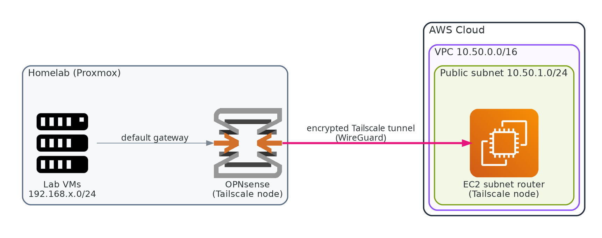

# Homelab connection: AWS VPC through Tailscale

A hands-on **learning guide**: build an AWS VPC from scratch, then connect it privately to a Proxmox + OPNsense homelab
using **Tailscale subnet routing** (no Site-to-Site VPN, no open ports at home). Every step explains *why*, shows the
calculations behind the address plan, and includes the real problems that came up and how they were diagnosed.

(Repository: `homelab-connection-vpc-through-tailscale`.)

## Learning path
| # | Chapter | You will learn |
|---|---|---|
| 1 | [IP addressing and CIDR](docs/01-ip-addressing-and-cidr.md) | binary, masks, `/16` vs `/24`, overlap checks, address planning, with exercises |
| 2 | [Build the VPC](docs/02-build-the-vpc.md) | VPC, subnet, gateway, route table, security group, EC2 — and why each exists |
| 3 | [Tailscale and the AWS router](docs/03-tailscale-subnet-router.md) | advertise vs accept, IP forwarding, approving routes |
| 4 | [The lab side (OPNsense)](docs/04-lab-side-opnsense.md) | accepting routes, advertising VLANs, the source-NAT fix |
| 5 | [Packet flows and testing](docs/05-packet-flows-and-testing.md) | proving both directions, `tcpdump` method, diagrams of what failed and why |
| — | [Glossary](docs/06-glossary.md) | |

Quick step list: [`gude.md`](gude.md)

## Prerequisites
- An AWS account (set a **budget alert** first), a Tailscale account, a Proxmox host with OPNsense (Tailscale plugin).
- Comfort with a terminal and SSH. No prior VPC knowledge needed.

## Status
| Path | State |
|---|---|
| Laptop ↔ AWS router, laptop ↔ lab VMs | Verified |
| AWS router → lab VM | Verified |
| Lab VM → AWS router | Verified **with an OPNsense source-NAT workaround** ([chapter 5](docs/05-packet-flows-and-testing.md)) |

Scope: this guide covers the tunnel and routing between the lab and the AWS router.

The instance used to build this was terminated afterwards to stop costs; the guide rebuilds it.

> All addresses are examples or private ranges. No keys, tokens or account identifiers belong in this repository.

Diagrams use the AWS Architecture Icons (© Amazon Web Services, via the open-source `diagrams` library). AWS and its icons are trademarks of Amazon.com, Inc. or its affiliates.
