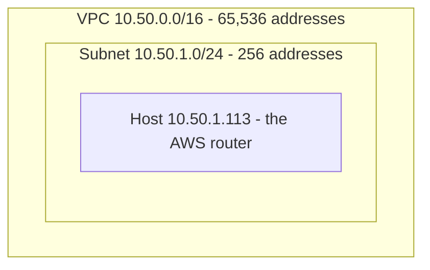

# 1. IP addressing and CIDR — the maths behind the design

Every choice in this project (`10.50.0.0/16` for the VPC, `10.50.1.0/24` for the subnet, `192.168.x.0/24` for lab
VLANs) comes from a few small calculations. Learn these once and the rest of the guide is easy to follow.

**What you will learn**
- How an IPv4 address is 32 bits and what a prefix such as `/24` means
- How to count addresses in a block and find the network a host belongs to
- Which ranges are private (RFC 1918) and which only look private
- Why networks you connect must not overlap
- Why this project uses a `/16` VPC and a `/24` subnet

Terms are defined in the [glossary](07-glossary.md) (CIDR, subnet, VPC, tailnet).

## 1.1 An IPv4 address is 32 bits
`10.50.1.113` is four numbers (octets), each 0–255, each really 8 bits:

```
10        . 50        . 1         . 113
00001010  . 00110010  . 00000001  . 01110001
```
*Why it matters:* routers and firewalls compare bits, not decimal numbers. Once you see the bits, masks stop being magic.

*Check:* 113 = 64 + 32 + 16 + 1 = `01110001`. Does that match the last octet above?

## 1.2 The prefix (`/16`, `/24`) says how many bits are the *network*
`10.50.1.0/24` means: the **first 24 bits are fixed (the network)**, the remaining **8 bits are free (the hosts)**.

```
number of addresses in a block = 2 ^ (32 − prefix)
```

| Prefix | Mask | Free bits | Addresses | Calculation |
|---|---|---|---|---|
| `/8`  | 255.0.0.0       | 24 | 16,777,216 | 2²⁴ |
| `/16` | 255.255.0.0     | 16 | **65,536** | 2¹⁶ |
| `/24` | 255.255.255.0   | 8  | **256**    | 2⁸ |
| `/28` | 255.255.255.240 | 4  | **16**     | 2⁴ |
| `/32` | 255.255.255.255 | 0  | 1          | 2⁰ (a single host) |

Why `.240`? A `/28` has 28 ones then 4 zeros: `11111111.11111111.11111111.11110000`, and `11110000` = 128+64+32+16 = **240**.

> A **bigger** prefix number means a **smaller** network.

> **Common mistake:** thinking `/28` is bigger than `/16` because 28 > 16. It is the other way round: `/28` has 16 addresses, `/16` has 65,536.

*Check:* without looking, how many addresses are in a `/24`? (256.)

## 1.3 Finding the network address (worked example)
Which network is `10.50.1.113/24` in? Bitwise-AND the address with the mask:

```
host   10.50.1.113  = 00001010.00110010.00000001.01110001
mask   /24          = 11111111.11111111.11111111.00000000
AND    ------------------------------------------------
result              = 00001010.00110010.00000001.00000000 = 10.50.1.0
```
So the network is `10.50.1.0/24` (range `10.50.1.0`–`10.50.1.255`) and `.113` is host number 113 inside it.

Blocks nest inside each other. The VPC, the subnet and the router host from this project look like this:


```
 10.50.0.0/16  ┌──────────────────────────────┐
               │ 10.50.1.0/24 ┌────────────┐  │
               │              │ .113 (host)│  │
               │              └────────────┘  │
               └──────────────────────────────┘
```
*Check:* the AND result keeps the first 24 bits and zeroes the last 8. Try it for `10.50.1.200/24`: you get the same network.

## 1.4 Usable addresses (AWS reserves 5 per subnet)
AWS keeps the first four and the last address of every subnet (network, VPC router, DNS, future use, broadcast).

```
usable in a /24 = 256 − 5 = 251        usable in a /28 = 16 − 5 = 11 (the smallest AWS allows)
```
*Why it matters:* a tiny subnet runs out of addresses sooner than the raw size suggests.

> **Common mistake:** counting 256 usable addresses in a `/24` on AWS. It is 251.

## 1.5 Private ranges (RFC 1918) — the only ones to use inside a lab
| Block | Range | Addresses |
|---|---|---|
| `10.0.0.0/8` | 10.0.0.0 – 10.255.255.255 | 16,777,216 |
| `172.16.0.0/12` | 172.16.0.0 – **172.31**.255.255 | 1,048,576 |
| `192.168.0.0/16` | 192.168.0.0 – 192.168.255.255 | 65,536 |

Edge cases that catch people out:
- `192.168.x.x` is private, but **`192.167.x.x` is not** (it is public internet space). One digit matters.
- `172.16`–`172.31` is private; `172.32.x.x` is not.
- Tailscale uses `100.64.0.0/10` (carrier-grade-NAT space): 2²² = **4,194,304** addresses for devices. Your private network of Tailscale devices is called a **tailnet**.

> **Common mistake:** assuming anything starting `192.` or `172.` is private. Only `192.168.x.x` and `172.16`–`172.31` are.

*Check:* is a `192.167.x.x` address private? (No.)

## 1.6 The one rule that matters most: networks you connect must not overlap
Tailscale (like any router) chooses a path by **prefix**. If two networks share addresses, a packet for
`10.50.1.5` could belong to either, and routing breaks. Check pairs before you build:

| Pair | Overlap? | Why |
|---|---|---|
| `10.50.0.0/16` (VPC) vs `192.168.0.0/16` (lab) | **No** | different blocks |
| `10.50.0.0/16` vs `100.64.0.0/10` (Tailscale) | **No** | different blocks |
| `10.50.0.0/16` vs `10.50.1.0/24` | Yes | the /24 sits *inside* the /16 (that's fine — it's a subnet, not a second network) |
| `172.17.0.0/16` vs `172.16.0.0/12` | Yes | Docker's default bridge is inside the private range — avoid it for VLANs |

*Check:* pick any two networks you plan to join and compare them in this table form before building.

## 1.7 The address plan used in this project
```
Tailscale devices   100.64.0.0/10        (4,194,304 addresses, managed by Tailscale)

AWS VPC             10.50.0.0/16         (65,536)
 └─ public subnet   10.50.1.0/24         (256 → 251 usable)   us-east-1a
      └─ router     10.50.1.113          (host #113)

Home lab            192.168.0.0/16       (65,536 available)
 ├─ 192.168.1.0/24   LAN          ├─ 192.168.40.0/24  deception
 ├─ 192.168.10.0/24  ai           ├─ 192.168.50.0/24  guests
 ├─ 192.168.20.0/24  blue         ├─ 192.168.60.0/24  targets
 └─ 192.168.30.0/24  cloud        └─ 192.168.70.0/24  manager (monitoring VM)
```

## 1.8 Why the VPC is a `/16` and the subnet a `/24`
**A VPC's main CIDR cannot be resized later** (you can only add extra ranges), and AWS allows **/16 (largest) to /28 (smallest)**.
So choosing the biggest block costs nothing and removes a future headache:

| Choice | Addresses | Subnets of /24 it can hold | Verdict |
|---|---|---|---|
| VPC `/16` | 65,536 | 2^(24−16) = **256** | Room for many subnets, regions of growth. Unused space is free |
| VPC `/24` | 256 | 2^(24−24) = **1** | One subnet and then you are stuck |
| Subnet `/24` | 256 (251 usable) | — | Plenty for a lab; uses 256 / 65,536 = **0.39 %** of the VPC |
| Subnet `/28` | 16 (11 usable) | — | Too tight if you add a few instances |

**Bonus — one route covers everything.** The AWS router advertises the single route `10.50.0.0/16` to Tailscale.
Any subnet you add later is automatically reachable, with no new routes. If you had advertised only `10.50.1.0/24`
you would need a new advertisement for every subnet.

**The same logic for the lab:** each VLAN is a `/24`, so a router interface address is `.1`, and the lab's `192.168.0.0/16`
could hold 256 such VLANs (we use 8).

> **Common mistake:** choosing a small VPC block "to save addresses". Unused private addresses cost nothing, and the main CIDR cannot be resized.

## 1.9 Choosing the size of an allow-list (the SSH-from-your-ISP lesson)
Our ISP shared public addresses, so AWS saw us from `.99`, `.102`, `.103`, `.105` and `.108` of the same `/24`:

| Rule | Addresses allowed to *try* port 22 | Result |
|---|---|---|
| `/32` (one address) | 1 | Failed whenever the ISP changed our address |
| `/28` covering `.96–.111` | 16 | Covers what we saw, but fragile |
| `/24` | 256 | Worked — but wider than ideal |
| `/16` | 65,536 | Needlessly open |

*Why it matters:* an allow-list is a size choice. Too narrow breaks you, too wide exposes you.

The best rule was none at all: after Tailscale was up, SSH went over the tunnel and the rule was deleted.

## 1.10 Practice
1. How many addresses are in a `/20`?
2. What network is `192.168.70.153/24` in?
3. How many usable addresses does an AWS `/26` subnet have?
4. Which of these first-two-octet pairs are private: `172.15.x.x`, `172.20.x.x`, `172.32.x.x`?
5. Does `192.168.1.0/24` overlap `192.168.0.0/16`?
6. How many `/24` subnets fit in a `/16`? In a `/20`?
7. Which network is `10.50.1.200/24` in, and is `10.50.2.5` in the same subnet?
8. Why can't a VPC use `10.0.0.0/8` as its main CIDR?

<details><summary>Answers</summary>

1. 2^(32−20) = 2¹² = **4,096**
2. `192.168.70.0/24` (the last octet is the host part)
3. 2^(32−26) = 64, minus 5 = **59**
4. Only `172.20.x.x` (the private range is 172.16.0.0–172.31.255.255)
5. **Yes** — the `/24` is inside the `/16`
6. 2^(24−16) = **256**; in a `/20`: 2^(24−20) = **16**
7. `10.50.1.0/24`; no, `10.50.2.5` is in `10.50.2.0/24`
8. AWS only allows a VPC CIDR between `/16` and `/28`; `/8` is too large
</details>

## Summary: what you learned
- A prefix `/n` fixes the first n bits; the block holds 2^(32−n) addresses.
- AWS reserves 5 addresses per subnet, so a `/24` has 251 usable.
- Use 10/8, 172.16/12 or 192.168/16 for private networks, and never overlap networks you connect.
- A `/16` VPC with `/24` subnets leaves room to grow and needs just one route.

Next: [2. Build the VPC](02-build-the-vpc.md)
