# 2. Build the AWS VPC, one piece at a time

We build each piece by hand (not the "VPC and more" wizard) so you see what every part does.
Region used: `us-east-1`. **Always check the region selector (top right) before each step.**

**What you will learn**
- What each AWS networking piece is (VPC, subnet, internet gateway, route table, security group, EC2) and why it exists
- What makes a subnet "public"
- Why a router instance needs the source/destination check turned off
- How to verify each step before moving on

Prerequisite: the address plan from [chapter 1](01-ip-addressing-and-cidr.md). Terms are in the [glossary](07-glossary.md).

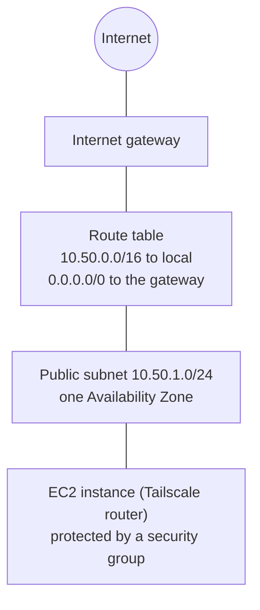
```
 Internet ── Internet gateway ── Route table ── Subnet 10.50.1.0/24 ── EC2 (+ security group)
```

## Step 0 — Safety first
Create a **budget alert** (Billing → Budgets → Monthly cost budget, e.g. $5) *before* launching anything.
Avoid the classic accidental costs: a **NAT Gateway** (about $32/month) and idle running instances.
*Why:* cloud mistakes are billed, so an alert is your safety net.
*Check:* the budget appears in the Budgets list.

## Step 1 — The VPC
*What:* your own private network inside AWS. Nothing gets in or out until you build the paths.
*How:* VPC → Create VPC → **VPC only** → name, IPv4 `10.50.0.0/16`, no IPv6, tenancy **Default** (dedicated tenancy costs much more) → then
*Actions → Edit VPC settings → enable DNS hostnames*.
*Why `/16`:* see [chapter 1.8](01-ip-addressing-and-cidr.md#18-why-the-vpc-is-a-16-and-the-subnet-a-24).
*Check:* state **Available**; AWS auto-created a main route table, a default network ACL and a default security group.

> **Common mistake:** creating the VPC in the wrong region. Check the selector first.

## Step 2 — The subnet
*What:* a slice of the VPC that lives in **one Availability Zone** (one or more data centres). Instances are launched into subnets.
*How:* Subnets → Create subnet → your VPC → name → **Availability Zone: choose one explicitly** (e.g. `us-east-1a`) → `10.50.1.0/24`.
Then *Edit subnet settings → enable auto-assign public IPv4*.
*Check:* **Available**, 251 free addresses (256 − 5 reserved).

> **Common mistake:** leaving the Availability Zone on "No preference" (see the lesson below).

> **Lesson learned (real mistake):** a subnet's zone **cannot be changed**. Ours first landed in `us-east-1e`, which does not offer
> many instance types (the console greyed them out with "not supported in us-east-1e"). Fix = delete and recreate in `us-east-1a`.
> Never leave "No preference" without checking where it ended up.

## Step 3 — The internet gateway
*What:* the door between the VPC and the internet. Free.
*Why:* without it the VPC has no path to the internet at all.
*How:* Internet gateways → Create → then **Actions → Attach to VPC**. A new gateway is *Detached* and does nothing.
*Check:* state **Attached**.

## Step 4 — The route table (this is what makes a subnet "public")
A route table is a list of directions: *"traffic for this destination goes to this next hop."* Rules are matched **most specific first**.

| Destination | Target | Meaning |
|---|---|---|
| `10.50.0.0/16` | `local` | traffic inside the VPC stays inside (AWS adds this; cannot be removed) |
| `0.0.0.0/0` | `igw-…` | everything else goes to the internet gateway |

*How:* Route tables → Create (in your VPC) → add the `0.0.0.0/0 → internet gateway` route → **Subnet associations → tick your subnet**.
*Check:* both routes **Active**; the subnet shows under *Explicit subnet associations*.

> **Common mistake:** forgetting the subnet association. The route exists, but the subnet still uses the main table.
>
> A subnet is *public* because its route table has a route to an internet gateway — **not** because of its name or the
> auto-assign-IP setting. A new subnet uses the **main** route table (no internet route) until you associate it.
>
> **Compare with OPNsense:** the route table is like a router's routing table (default route + connected networks).
> In AWS each subnet uses exactly one route table (and one table can serve many subnets); OPNsense has one table for the whole box.

## Step 5 — The security group (the instance firewall)
*Why:* it is your first line of defence for each instance. Default-deny means you only open what you need.
Facts to remember:
- It filters traffic at the **instance**, and only **allows** (there are no deny rules). Anything not allowed is blocked.
- It is **stateful**: replies to allowed traffic are let back automatically.
- A new group starts with **no inbound rules** and **allow-all outbound**.

For this project: **no inbound rules are needed for Tailscale** (it only connects outward). Keep the default outbound rule
(*All traffic → 0.0.0.0/0*) — the instance must reach the internet to install packages and talk to Tailscale.
We used a temporary SSH rule only to bootstrap, then removed it (see [troubleshooting](../TROUBLESHOOTING.md)).
Our ISP shared public addresses, so a single-address (`/32`) SSH rule failed ([chapter 1.9](01-ip-addressing-and-cidr.md#19-choosing-the-size-of-an-allow-list-the-ssh-from-your-isp-lesson)).

*Check:* the group shows no inbound rules (or only your temporary SSH rule) and the default outbound rule.

**Network ACL?** The subnet also has a default network ACL that allows everything. It is *stateless* (you must allow both directions),
so it is easy to break things with. We left it alone.

## Step 6 — The EC2 instance (the Tailscale router)
Ubuntu Server 24.04 LTS, a small instance type that your zone supports (an Arm `t4g.*` needs the **Arm** image; `t3.*` needs **x86**),
your subnet, **auto-assign public IP on**, your security group, an ED25519 key pair (`chmod 600` the `.pem`).

Then: **Actions → Networking → Change source/destination check → Stop**.
*Why:* AWS normally drops packets that are not to or from the instance itself. A router forwards other machines' packets, so
without this the link silently fails.
*Check:* Running with **2/2 status checks passed**.

> **Common mistake:** picking an Arm instance type with an x86 image (or the reverse). The launch will not match.
> Another: skipping the source/destination check. The tunnel comes up but forwarding silently fails.

## Step 7 — Verify before moving on
| Check | Expected |
|---|---|
| Route table | `local` and `0.0.0.0/0 → igw` both Active |
| Subnet | in the zone you chose, auto-assign public IPv4 = Yes |
| Gateway | Attached |
| Instance | Running, 2/2 checks, has a public IPv4 |

### What it looks like (screenshots, with account and ID details blacked out)

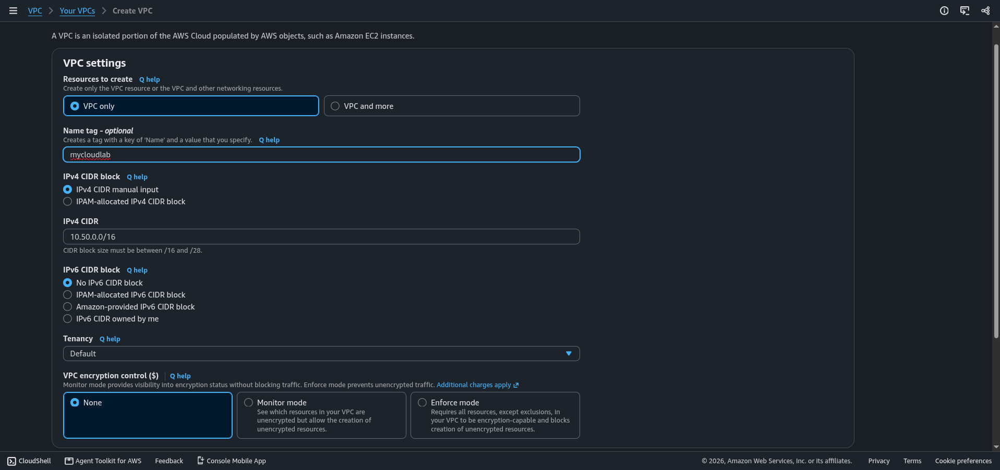
*Step 1: the Create VPC form (VPC only, 10.50.0.0/16, no IPv6, default tenancy).*

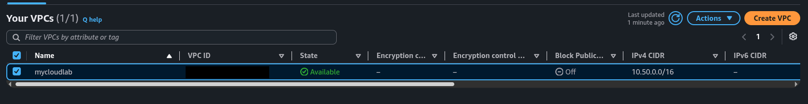
*Step 1 check: the VPC is Available.*

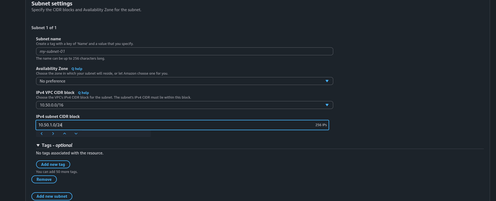
*Step 2: the subnet form. Pick the Availability Zone yourself instead of leaving No preference.*

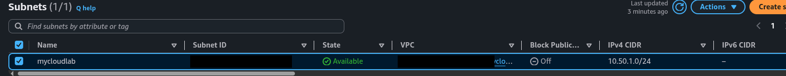
*Step 2 check: the subnet is Available.*

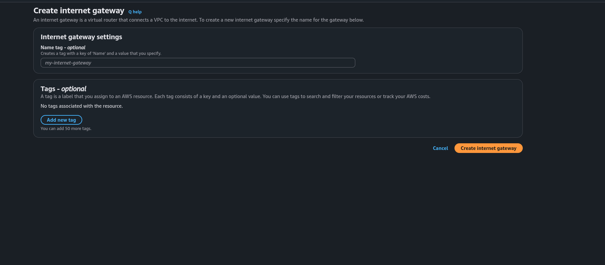
*Step 3: create the internet gateway.*

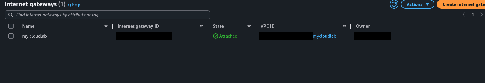
*Step 3 check: the gateway is Attached to the VPC.*

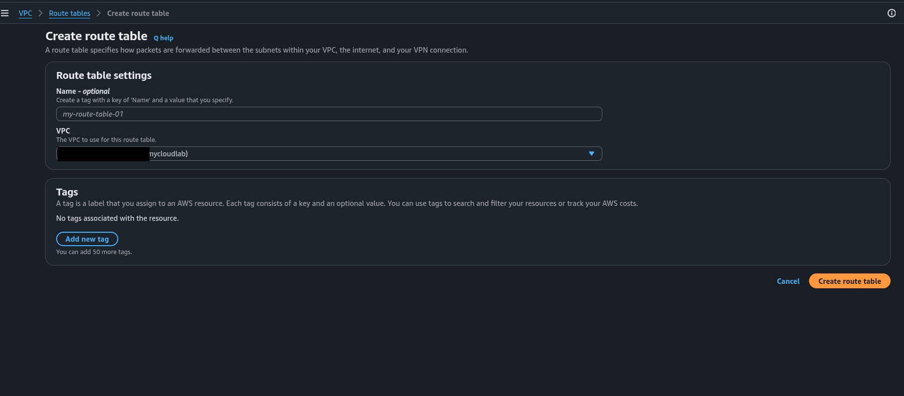
*Step 4: create the route table in the VPC.*

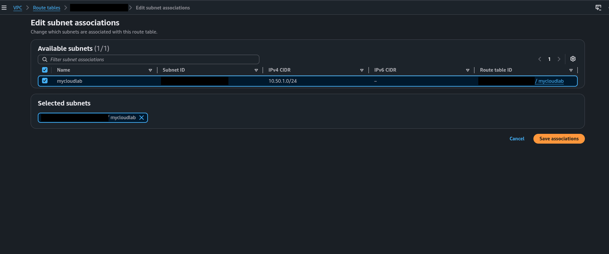
*Step 4: associate the subnet with the route table.*

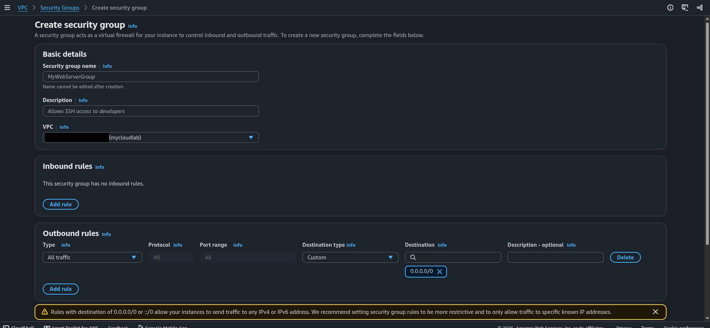
*Step 5: no inbound rules, default outbound allow-all.*

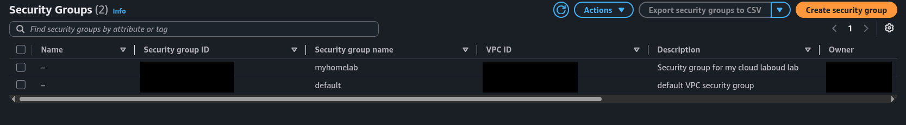
*Step 5 check: the new group and the VPC's default group.*

## Summary: what you learned
- A VPC is empty until you add a subnet, an internet gateway and a route to it.
- A subnet is public because of its route table, and its Availability Zone cannot be changed.
- A security group is a stateful, allow-only instance firewall. Tailscale needs no inbound rule.
- A router instance needs the source/destination check disabled.

## Try it yourself
1. Your instance has a public IP but cannot reach the internet. Name two things to check.
2. Why is there no deny rule in a security group?
3. What does the `local` route do?

<details><summary>Answers</summary>

1. The internet gateway is attached, and the subnet is associated with a route table that has `0.0.0.0/0` to the gateway.
2. Security groups only allow. Anything not allowed is blocked by default.
3. It keeps traffic between addresses inside `10.50.0.0/16` inside the VPC. AWS adds it and it cannot be removed.
</details>

Next: [3. Tailscale on the AWS router](03-tailscale-subnet-router.md)
