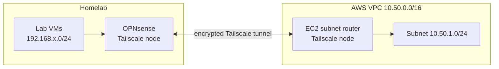

# 3. Tailscale and the AWS subnet router

**What you will learn**
- What a tailnet and a subnet router are
- The difference between advertising and accepting routes
- How to enable IP forwarding, install Tailscale safely and approve a route
- What a successful ping does and does not prove

Terms are in the [glossary](07-glossary.md).

## 3.1 What Tailscale gives you
- A private **tailnet** (your own private Tailscale network): every device gets an address in `100.64.0.0/10` and talks to the others over encrypted **WireGuard** tunnels.
- **No inbound ports** on your home router or your AWS security group: both ends connect *outward* and meet through Tailscale's
  coordination service. If a direct path is impossible, traffic goes through a **relay (DERP)** — slower but it works
  (we saw ~220–260 ms through relays between a home lab and the US).
- Devices can also act as **subnet routers**: a subnet router is a Tailscale node that lets the tailnet reach a whole network behind it.

## 3.2 Why we need a machine in AWS
A VPC is only a network; it has no computer to run Tailscale. The small EC2 instance is the **AWS end of the tunnel** and the
**router** between `10.50.0.0/16` and the tailnet.
*Check:* you can name the two ends of the tunnel (EC2 router and OPNsense) from the diagram below.



## 3.3 Advertise vs accept — the most important idea
| Setting | Meaning | Who sets what |
|---|---|---|
| **Advertise routes** | "I have a network *behind me*; send me that traffic" | AWS router advertises `10.50.0.0/16`; OPNsense advertises the lab VLANs |
| **Accept routes** | "I will *use* routes that other nodes advertise" | Both routers (and your laptop) must accept, or they cannot reach the other side |

Never advertise a network from a node that does not own it (e.g. do not advertise `10.50.0.0/16` from OPNsense): it would
claim a path to AWS and cause loops or black holes. And **approving** a route in the admin console is a separate, required step.

> **Common mistake:** advertising a route but forgetting to accept routes on the other side, or forgetting to approve it. Either way the other end cannot reach the network.

## 3.4 Prepare the instance (SSH in)
```sh
ssh -i <key>.pem ubuntu@<public-ip>

# let Linux forward packets that are not addressed to itself
echo 'net.ipv4.ip_forward = 1' | sudo tee /etc/sysctl.d/99-tailscale.conf
sudo sysctl -p /etc/sysctl.d/99-tailscale.conf        # expect: net.ipv4.ip_forward = 1
```
`tee` writes the file as root so it persists across reboots; `sysctl -p <file>` loads it now.
*Why:* by default Linux drops packets not addressed to itself. A router must forward them.
*Check:* the command prints `net.ipv4.ip_forward = 1`.

## 3.5 Install Tailscale (read the script first)
```sh
curl -fsSL https://tailscale.com/install.sh -o tailscale-install.sh
less tailscale-install.sh          # read it, press q to leave
sudo sh tailscale-install.sh
```
`curl -fsSL`: `-f` fail on HTTP errors, `-s` silent, `-S` still show errors, `-L` follow redirects; `-o` saves instead of running.
Avoid `curl … | sh`: it runs code you never read.
*Check:* `tailscale version` runs (install completed).

## 3.6 Join the tailnet and advertise the VPC
```sh
sudo tailscale up --advertise-routes=10.50.0.0/16 --accept-routes --hostname=aws-router
```
It prints a login link — open it in your browser and sign in to your tailnet (no auth key is typed or stored on the server).

Then in the Tailscale **admin console → Machines → aws-router → ⋯ → Edit route settings**: **approve** `10.50.0.0/16`.
Also **Disable key expiry** for a router, or the link silently dies when the key expires (the console warns about this).
*Why:* the node only joins after you sign in, and the route only works after you approve it.
*Check:* the machine shows `10.50.0.0/16` as an approved subnet route.

> **Common mistake:** leaving key expiry on. The router vanishes from the tailnet later with no obvious cause.

## 3.7 Verify
From any device that accepts routes (e.g. your laptop):
```sh
tailscale status                      # aws-router is online
ping <router-private-ip>              # e.g. 10.50.1.113 — replies mean the tunnel and route work
```
> Note: pinging the router's *own* address proves the tunnel, not forwarding. Forwarding is proved only by reaching a
> **different** machine through the router (see chapter 5).

## Summary: what you learned
- A tailnet connects devices over encrypted tunnels without inbound ports.
- A subnet router advertises a network. Other nodes must accept routes, and an admin must approve them.
- IP forwarding must be on for the Linux router to forward packets.
- Pinging the router proves the tunnel. Only reaching a second machine proves forwarding.

## Try it yourself
1. What is the difference between advertise and accept?
2. Why is no inbound security-group rule needed?
3. Why disable key expiry on the router?

<details><summary>Answers</summary>

1. Advertise says "I have this network behind me". Accept says "I will use routes others advertise".
2. Both ends connect outward to Tailscale, so nothing has to connect in.
3. Otherwise the link silently dies when the key expires.
</details>

Next: [4. The lab side (OPNsense)](04-lab-side-opnsense.md)
