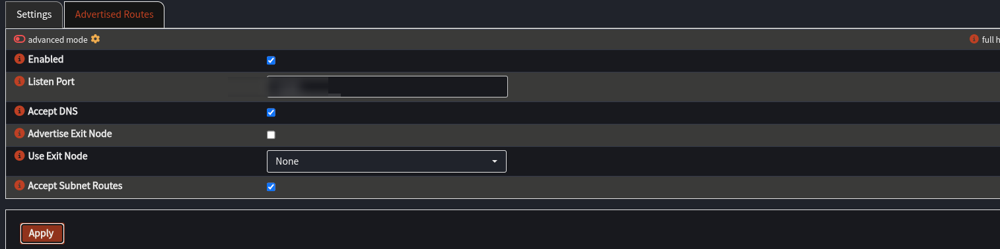
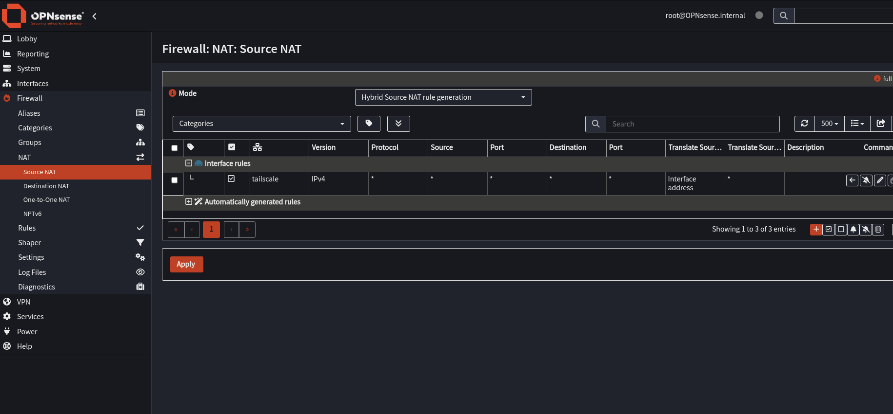

# 4. The lab side: OPNsense as the second subnet router

**What you will learn**
- Why OPNsense is the natural Tailscale node for the lab
- What **Accept Subnet Routes** does and what happens without it
- What **source NAT** is and why it fixed lab to AWS traffic
- Which routes to advertise (and which never to)

OPNsense is already the router between your VLANs, so it is the natural Tailscale node for the lab: any lab VM that uses it
as gateway can reach the tunnel with no extra setup on the VM.

## 4.1 Settings
| Where | Setting | Value |
|---|---|---|
| Settings tab | Enabled | on |
| Settings tab | **Accept Subnet Routes** | **on** — teaches OPNsense that `10.50.0.0/16` lives behind the AWS router |
| Advertised Routes tab | list | **only the lab VLANs**, e.g. `192.168.70.0/24` — **never** `10.50.0.0/16` |

After saving, confirm the route exists: **System → Routes → Status** should show
`10.50.0.0/16 → tailscale0`. If the box was unticked, that line is missing and traffic for AWS goes out the WAN and is lost
(we reproduced this: unticking it broke lab → AWS, ticking it fixed it).

Advertise **only what AWS should reach** (least exposure). Names here: `cloud`, `manager`, … are examples of VLAN names.
*Why:* accepting routes teaches OPNsense where AWS is. Advertising tells AWS which lab networks exist.
*Check:* System → Routes → Status shows `10.50.0.0/16 → tailscale0`, and the admin console shows your lab routes approved.

> **Common mistake:** advertising `10.50.0.0/16` from OPNsense, or leaving Accept Subnet Routes off. Lab traffic for AWS then leaves via the WAN and is lost.

## 4.2 How VLANs talk to each other
Each VLAN is its own `/24`. VMs send traffic for other networks to their VLAN gateway (OPNsense, `.1`); OPNsense checks its
firewall rules on the interface where the packet arrives, then routes it. Check a VM's gateway with `ip route get <target>`.
*Check:* the output of `ip route get` names OPNsense (the `.1` address) as the next hop.

## 4.3 The Source NAT rule that made lab → AWS work
Without it, replies from AWS were lost (chapter 5 shows exactly how we proved this). The fix is **source NAT** on the
Tailscale interface: rewrite the lab VM's source address to OPNsense's own Tailscale address.

OPNsense 26.x: **Firewall → NAT → Source NAT** (called *Outbound* in older versions) → add:

| Field | Value |
|---|---|
| Interface | `tailscale` |
| TCP/IP version | IPv4 |
| Protocol | any |
| Source / Destination | `any` / `any` (the form rejected typed CIDRs; use `any` or create *Aliases* of type Network(s)) |
| Translate source IP | leave empty = the interface address |

Save, then **Apply**. Trade-off: AWS sees all lab traffic as coming from OPNsense.

*Why:* **source NAT** rewrites the source address of outgoing packets. With it, the AWS side sees OPNsense's Tailscale address instead of the VM's subnet address, and replies return to that address. We do not have proof of exactly why the replies were lost without it.
*Check:* ping the AWS router's private address from a lab VM. Replies come back (chapter 5 covers testing).

> **Common mistake:** forgetting to click **Apply** after saving the rule, so nothing changes.

*OPNsense: VPN → Tailscale → Settings, with Accept Subnet Routes ticked.*

*OPNsense: Firewall → NAT → Source NAT, a rule on the tailscale interface that translates to the interface address.*

## Summary: what you learned
- OPNsense is the lab's subnet router. It must accept subnet routes to reach AWS.
- Advertise only lab networks, never the AWS one.
- A source NAT rule on the tailscale interface made lab to AWS replies work.
- The trade-off is that AWS sees all lab traffic as coming from OPNsense.

## Try it yourself
1. What breaks if Accept Subnet Routes is off?
2. Why advertise only some VLANs?
3. What does the source NAT rule change in a packet?

Answers

1. OPNsense has no route to `10.50.0.0/16`, so traffic goes out the WAN and is lost.
2. Least exposure: AWS can only reach networks you chose to share.
3. Its source address becomes OPNsense's own Tailscale address.

Next: [5. Packet flows and testing](05-packet-flows-and-testing.md)
