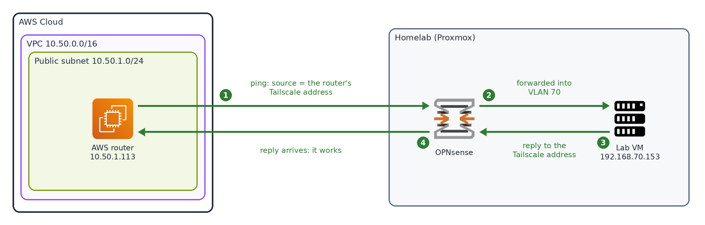
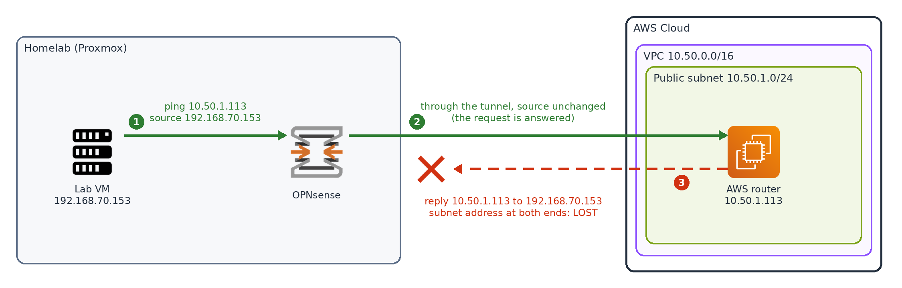
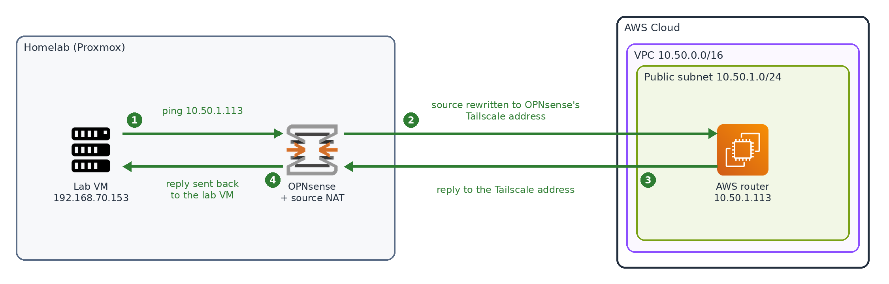
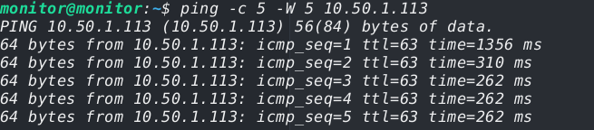
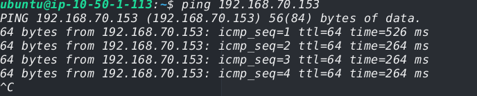

# 5. Packet flows, testing, and the problem we had to solve

This chapter is the heart of the project: how to *prove* a network works, and what we learned when one direction did not.

**What you will learn**
- Which test proves which part of the path
- How packets flow in the working, failing and fixed cases
- A reusable method: capture, rule out layers, bisect, then fix

## 5.1 Test both directions, and know what each proves
| Test | Run on | Proves |
|---|---|---|
| `tailscale ping aws-router` | any node | the tunnel itself |
| `ping <router-private-ip>` | laptop / lab VM | the route to AWS exists |
| `ping <lab-vm>` | AWS router | AWS → lab works |
| `ping <router-private-ip>` | lab VM | lab → AWS works |
| ping a **second** VPC machine | lab | that the router *forwards* (not only answers) |

`ttl` hint (use with care): a normal router hop lowers the TTL by one, and replies from a Linux host start at 64. We saw `ttl=63` on
lab → AWS replies but `ttl=64` on AWS → lab replies, even though both crossed OPNsense. Tunnel software can re-create packets, so TTL is
only a hint, never proof of how many routers a packet crossed.
*Check:* run the first two tests from a laptop before touching the lab side. If they fail, fix chapter 3 first.

> **Common mistake:** pinging the router's own address and calling forwarding "proven". It only proves the tunnel.

## 5.2 What worked from the start: AWS → lab
When the AWS router pings a lab VM, Linux chooses its **Tailscale address** as the source (the route to the lab is via `tailscale0`).
In our tests, Tailscale delivered traffic whenever at least one end was a *device address*.
*Check:* from the AWS router, ping a lab VM. Replies come back. This direction was verified working.

## 5.3 What failed: lab → AWS
The VM pings the router. The request reaches AWS and is answered, but the reply (source `10.50.1.113`, destination
`192.168.70.153` — **a subnet address at both ends**) never reaches OPNsense.

*Why show this:* the request clearly arrives and is answered, so the loss happens on the way back.

## 5.4 The fix: source NAT on OPNsense

*Check:* after the NAT rule, the same ping from the VM now succeeds. Lab to AWS was verified working.

*Run on the lab VM (prompt `monitor@monitor`) after the NAT rule: 5 of 5 replies from the AWS router.*

*Run on the AWS router (prompt `ubuntu@ip-10-50-1-113`): replies from the lab VM.*

## 5.5 How we found it
1. **Reproduce and measure** — never guess. Ping from the VM and watch.
2. **Capture on both sides of each hop** with `tcpdump`:
   - AWS router: `sudo tcpdump -ni tailscale0 icmp` → requests arrive, **replies are sent** (so AWS is fine).
   - OPNsense: `tcpdump -ni tailscale0 icmp` → requests leave, **no reply ever arrives**.
   - VM: `sudo tcpdump -ni ens18 icmp` → requests leave, **nothing returns**.
   Captures on `tailscale0` are taken *before* the firewall, so an absent packet was not blocked by firewall rules.
3. **Rule out layers one by one**, with a test each: security group, network ACL, Tailscale access policy, OPNsense firewall log,
   VLAN/bridge, the VM's own firewall. (A security group filters the *encrypted outer packets* on the normal network card; it cannot see the pings inside the tunnel,
   which appear on `tailscale0` after decryption. That is why pinging the router worked with no ICMP rule.)
4. **Bisect with a controlled packet:** force the source address with `ping -I`.

   | Source → destination | Delivered into OPNsense? |
   |---|---|
   | Tailscale address → lab VM | yes |
   | `10.50.1.113` → OPNsense's own Tailscale address | yes |
   | **`10.50.1.113` → lab VM** | **no** |

   Only the combination *subnet address ↔ subnet address* fails.
5. **Pick a fix that turns the failing case into a working one** (NAT → one end becomes a Tailscale address) and re-test.

> **Common mistake:** changing several things at once. You then cannot tell which one fixed it.

## Summary: what you learned
- Test both directions. Pinging the router proves the tunnel, not forwarding.
- Lab to AWS lost its replies when both ends were subnet addresses. Source NAT on OPNsense fixed it.

## Try it yourself
1. Why does `tcpdump` on `tailscale0` show that the firewall did not drop the missing reply?
2. Which source and destination combination failed?
3. Why force the source with `ping -I`?

Answers

1. Captures on `tailscale0` happen before the firewall, so a packet that never appears was not blocked by firewall rules.
2. Source `10.50.1.113` to a lab VM (subnet address at both ends).
3. To bisect: it lets you test one source and destination combination at a time.

