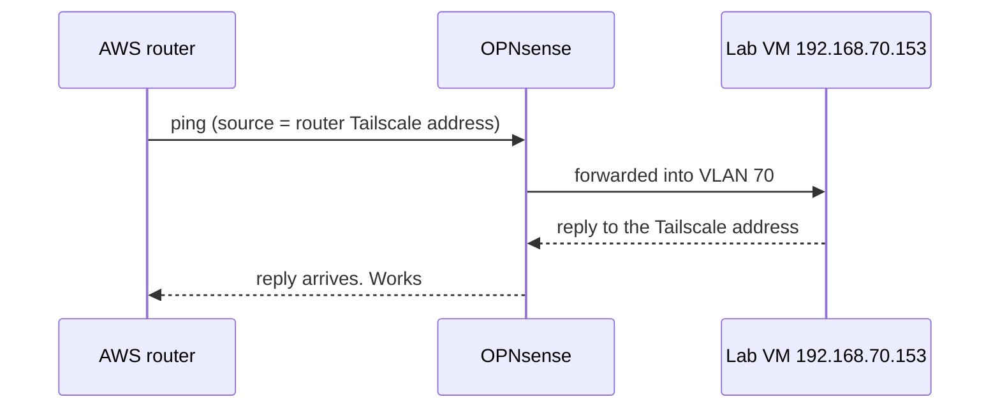
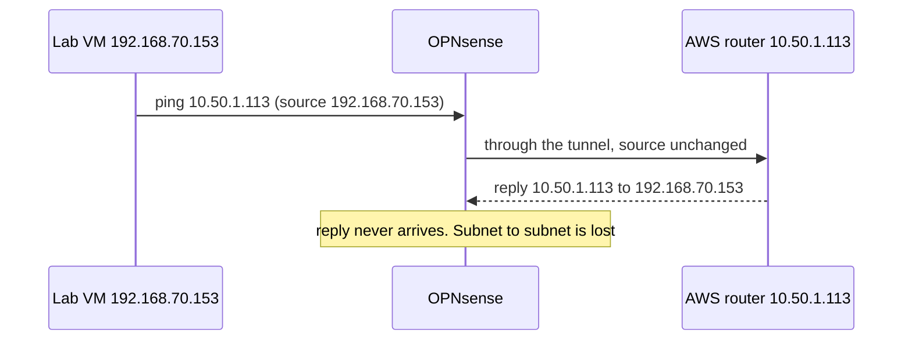
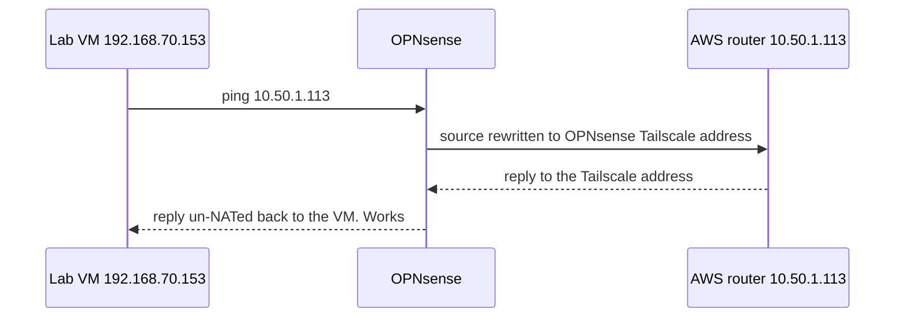

# 5. Packet flows, testing, and the problem we had to solve

This chapter is the heart of the project: how to *prove* a network works, and what we learned when one direction did not.

## 5.1 Test both directions, and know what each proves
| Test | Run on | Proves |
|---|---|---|
| `tailscale ping aws-router` | any node | the tunnel itself |
| `ping <router-private-ip>` | laptop / lab VM | the route to AWS exists |
| `ping <lab-vm>` | AWS router | AWS → lab works |
| `ping <router-private-ip>` | lab VM | lab → AWS works |
| ping a **second** VPC machine | lab | that the router *forwards* (not only answers) |

`ttl` hint: each router hop lowers the TTL by one. Replies from a Linux host start at 64, so `ttl=63` means the packet crossed
one router (OPNsense).

## 5.2 What worked from the start: AWS → lab
When the AWS router pings a lab VM, Linux chooses its **Tailscale address** as the source (the route to the lab is via `tailscale0`).
Tailscale accepts traffic that has a *device address* at one end.



## 5.3 What failed: lab → AWS (no NAT)
The VM pings the router. The request reaches AWS and is answered, but the reply (source `10.50.1.113`, destination
`192.168.70.153` — **a subnet address at both ends**) never reaches OPNsense.



## 5.4 The fix: source NAT on OPNsense

Plain-text version of the three flows:
```
works :  AWS router (src 100.x) ───────────────────────▶ lab VM
fails :  lab VM (src 192.168.70.153) ──▶ AWS router ──▶ reply (src 10.50.1.113 → dst 192.168.70.153)  ✗ lost
fixed :  lab VM → OPNsense (src rewritten to 100.x) ──▶ AWS router ──▶ reply to 100.x  ✓
```

## 5.5 How we found it (a method you can reuse)
1. **Reproduce and measure** — never guess. Ping from the VM and watch.
2. **Capture on both sides of each hop** with `tcpdump`:
   - AWS router: `sudo tcpdump -ni tailscale0 icmp` → requests arrive, **replies are sent** (so AWS is fine).
   - OPNsense: `tcpdump -ni tailscale0 icmp` → requests leave, **no reply ever arrives**.
   - VM: `sudo tcpdump -ni ens18 icmp` → requests leave, **nothing returns**.
   Captures on `tailscale0` are taken *before* the firewall, so an absent packet was not blocked by firewall rules.
3. **Rule out layers one by one**, with a test each: security group, network ACL, Tailscale access policy, OPNsense firewall log,
   VLAN/bridge, the VM's own firewall. (A security group does not even see Tailscale traffic to the router itself: it enters
   through `tailscale0`, not the normal network card.)
4. **Bisect with a controlled packet:** force the source address with `ping -I`.

   | Source → destination | Delivered into OPNsense? |
   |---|---|
   | Tailscale address → lab VM | yes |
   | `10.50.1.113` → OPNsense's own Tailscale address | yes |
   | **`10.50.1.113` → lab VM** | **no** |

   Only the combination *subnet address ↔ subnet address* fails.
5. **Pick a fix that turns the failing case into a working one** (NAT → one end becomes a Tailscale address) and re-test.

## 5.6 Why does it fail? (honest status)
Not proven. The documentation we found says Tailscale's site-to-site mode is specified for **Linux** routers on both sides,
and it needs a setting (`--snat-subnet-routes=false`) that does not exist on FreeBSD/OPNsense; an OPNsense forum thread
reports the same symptom and the same NAT workaround. Treat that as the *likely* explanation, not a confirmed one.

## 5.7 What is still untested
Reaching a **second machine inside the VPC** (not just the router). Expect to need: a VPC route `192.168.x.0/24 → router`,
security-group rules on that machine, and probably a masquerade on the AWS router for VPC-to-lab traffic.

Next: [6. Cost and clean-up](06-cost-and-cleanup.md) · Problem log: [TROUBLESHOOTING.md](../TROUBLESHOOTING.md)
